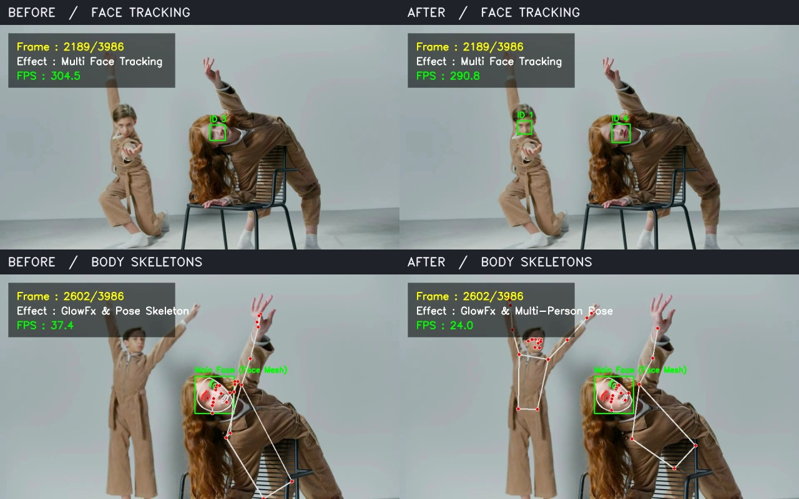
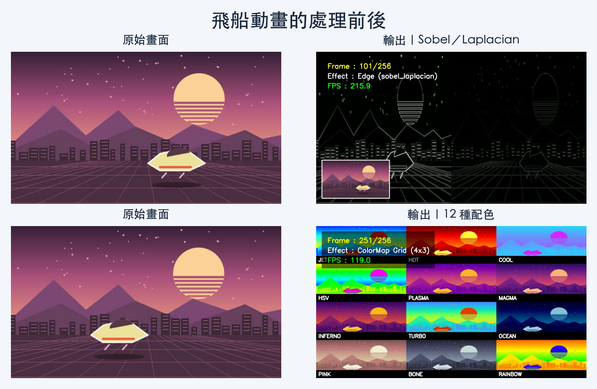

# openCV影像辨識學習

這是一個替影片加特效的小工具。它會按影片時間切換效果，像是描出輪廓、換色、切成四格，或畫出人臉追蹤框和人體骨架。短片只會看到片長涵蓋的效果。

[特效原理與圖解](docs/opencv-effect-notes.md)

## 效果預覽

### 雙人舞 | 完整特效

這是主要示範。用同一段雙人舞跑完 2 分 13 秒的特效，輸出為 29.97 fps。下圖左側是舊版，右側是雙人模式。新版能更常同時框住兩張臉，並畫出兩人的骨架。



雙人舞素材由 cottonbro studio 提供，依 Pexels 授權使用。素材經裁切、重複剪接和幀率轉換，輸出無音軌。 [原始素材](https://www.pexels.com/video/young-people-dancing-while-looking-at-camera-6724468/) · [Pexels 授權](https://www.pexels.com/license/)

### 飛船 | 短片示範

用程式繪製的原創飛船動畫，示範輪廓對照和多種配色。下圖左邊是原畫面，右邊是程式的實際輸出。



### 完整特效時間表

完整示範長 2 分 13 秒。影片會按下列時間順序切換效果。

| 時間 | 效果 |
| --- | --- |
| 0–10 秒 | 原畫面 |
| 10–17 秒 | 左邊 Sobel，右邊 Laplacian |
| 17–23 秒 | 左邊 Canny，右邊形態學梯度 |
| 23–30 秒 | DoG 輪廓 |
| 30–35 秒 | 12 種配色格子 |
| 35–42 秒 | 縮放與旋轉 |
| 42–50 秒 | 四格翻轉 |
| 50–60 秒 | ORB 特徵點 |
| 60–65 秒 | SIFT 特徵點 |
| 65–78 秒 | 多人臉追蹤與編號 |
| 78–115 秒 | 主要人臉的網格與柔光 |
| 83–132 秒 | 人體骨架，前段與臉部效果一起顯示 |
| 132 秒後 | 回到原畫面 |

Sobel／Laplacian 和 Canny／形態學梯度都是用同一幀畫面左右並排。這兩組和 DoG 段落的左下角會出現原畫面小窗，SIFT 也有。

## 安裝

在 Mac 上準備 Python 3.11。用終端機進入專案資料夾，再執行下面兩行。

```bash
python3.11 -m venv .venv-macos
.venv-macos/bin/python -m pip install -r requirements.txt
```

## 用自己的影片

把下面的 `我的影片.mp4` 換成你的檔名。影片在其他資料夾時，請填完整路徑。

```bash
.venv-macos/bin/python main.py --input "我的影片.mp4" --output "處理結果.mp4"
```

`--input` 是要處理的影片，`--output` 是結果的檔名。輸出用新的 `.mp4` 檔名。如果檔案已存在，工具會停止並請你換個檔名。

## 雙人模式

準備 Google 的 [Pose Landmarker Full 模型](https://storage.googleapis.com/mediapipe-models/pose_landmarker/pose_landmarker_full/float16/1/pose_landmarker_full.task)，放在專案內的 `models/` 資料夾。用下面的指令開啟雙人模式。

```bash
.venv-macos/bin/python main.py --input "我的雙人影片.mp4" --output "雙人結果.mp4" --multi-person models/pose_landmarker_full.task
```

省略 `--multi-person` 時，骨架仍使用原本的單人模式。雙人模式會增加處理量，轉身或互相遮擋時仍可能短暫漏框或換編號。

## 預覽與取消

處理時會自動開啟預覽。**在預覽視窗按 Esc，會取消這次處理並關閉視窗，結果檔也不會留下。** 想直接處理、不開視窗，可以在指令末尾加上 `--no-preview`。
