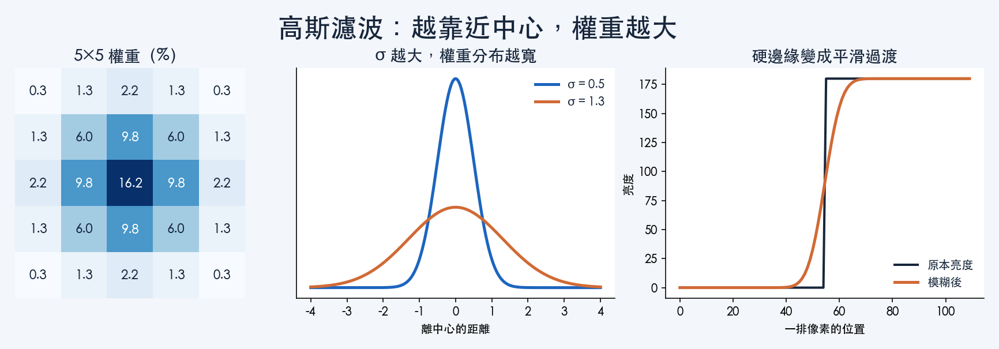
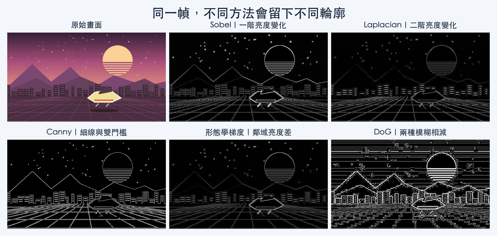
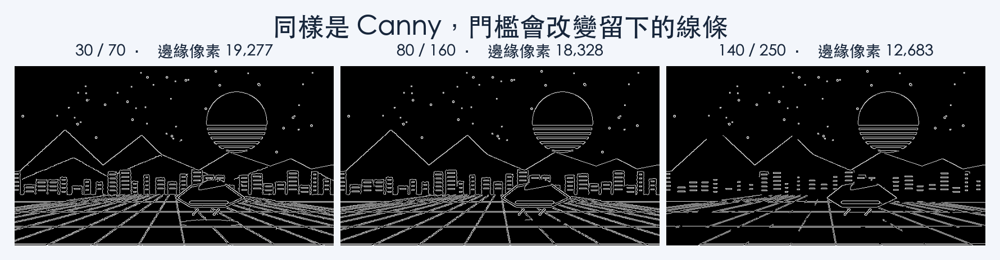
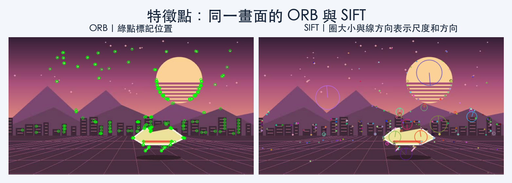
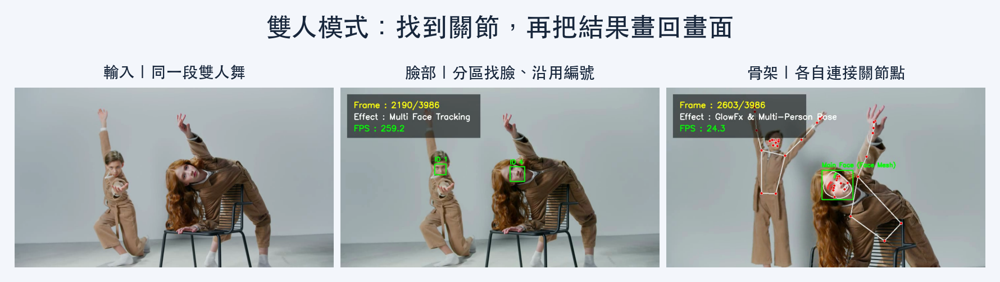

# openCV影像辨識學習｜特效原理筆記

每一幀都是一張圖。輪廓效果在找亮度變化，配色和翻轉在改像素，追蹤與骨架則用模型找出臉或關節，再把結果畫回影片。

## 平滑與輪廓

- **高斯濾波（Gaussian Blur）**。每個像素改成周圍像素的加權平均，離中心越近，權重越高，分布形狀像一座鐘。標準差 `σ` 越大，較遠的像素影響越大，畫面通常越模糊。它能壓低小雜點，也會讓細線變淡。本專案 把它用在 DoG、主臉柔光和滑鼠框選模糊。 [OpenCV 影像平滑](https://docs.opencv.org/4.x/d4/d13/tutorial_py_filtering.html)

- **Sobel／Laplacian（10–17 秒）**。左邊 Sobel 看亮度往水平方向和垂直方向變了多少，程式把兩個方向的絕對值各取一半加起來。右邊 Laplacian 看亮度的變化速度又變了多少，也就是二階導數。它對突變和細節更敏感，雜點也可能更明顯。 [OpenCV 影像梯度](https://docs.opencv.org/4.x/d5/d0f/tutorial_py_gradients.html)
- **Canny／形態學梯度（17–23 秒）**。左邊 Canny 先找亮度變化，再把寬邊緣收成細線。強邊緣直接保留，弱邊緣要能連到強邊緣才保留。右邊用的是另一個方法，取每個 `3×3` 區域最亮與最暗的差值，所以常呈現成較寬、有灰階深淺的輪廓。兩邊是同一幀各算一次，左邊的結果沒有拿去做右邊的運算。 [OpenCV Canny](https://docs.opencv.org/4.x/da/d22/tutorial_py_canny.html) · [OpenCV 形態學運算](https://docs.opencv.org/4.x/d9/d61/tutorial_py_morphological_ops.html)

- **同樣用 Canny，畫面也可能不同**。本專案 的低、高門檻是 `80` 和 `160`。門檻往下調，更多細節和雜點可能被留下。門檻往上調，較淡的輪廓可能消失。若先自行做高斯模糊，小紋理會變淡，線條可能更乾淨。本專案 這個分支是轉成灰階後直接呼叫 `Canny`，未額外呼叫 `GaussianBlur`。 [程式](../modules/edge.py) · [OpenCV Canny](https://docs.opencv.org/4.x/da/d22/tutorial_py_canny.html)

- **DoG 高斯差分（23–30 秒）**。把同一張灰階圖分別模糊兩次，再相減。大片平坦區的兩次結果接近，輪廓和紋理附近則差得較多。本專案 用 `5×5` 視窗，`σ` 分別為 `0.5` 和 `1.3`，再把差值拉到 0–255。現有程式直接相減的是 8 位無號整數，負差會繞回正值，這會影響輪廓看起來有多亮。 [程式](../modules/edge.py) · [Lowe 的高斯差分說明](https://www.cs.ubc.ca/~lowe/papers/ijcv04.pdf)

## 配色與畫面變形

- **12 種配色（30–35 秒）**。先轉成灰階，再把每個亮度換成色盤指定的顏色。同一個亮度在 HOT 可能偏紅，在 COOL 可能偏藍，因此同一畫面會有 12 種配色。 [程式](../modules/colormap.py)
- **縮放與旋轉（35–42 秒）**。依進度把畫面從 30% 放大到 100%，放在黑底中央，並繞中心旋轉一圈。畫面原本沒有像素的地方會看到黑底。 [程式](../modules/geometry.py)
- **四格翻轉（42–50 秒）**。同一幀縮成四份，左上原圖，右上左右鏡像，左下上下翻轉，右下同時左右和上下翻轉。 [程式](../modules/geometry.py)

## ORB 與 SIFT 特徵點

- **ORB（50–60 秒）**。先用 FAST 找像角落這樣容易辨認的位置，再用周圍像素的亮暗比較來描述它。本專案 設定最多 300 個點，每 5 幀計算一次，所以有些幀會看到綠點，有些幀是原畫面。 [程式](../modules/features.py) · [OpenCV ORB](https://docs.opencv.org/4.x/d1/d89/tutorial_py_orb.html)
- **SIFT（60–65 秒）**。在不同模糊尺度找特徵，再用附近輪廓的方向來描述它。本專案 每幀都算，並以圓圈大小和線條方向畫出特徵點的尺度與方向。ORB 和 SIFT 在這裡都用來顯示特徵點。 [程式](../modules/features.py) · [OpenCV SIFT](https://docs.opencv.org/4.x/da/df5/tutorial_py_sift_intro.html)

## 找臉、追蹤與骨架

- **人臉追蹤（65–78 秒）**。MediaPipe 隔幾幀重新找臉，中間由 OpenCV 的 KCF 根據臉周圍的外觀更新框的位置。新舊框的位置重合時，程式盡量沿用同一個編號。雙人模式每 5 幀補一次偵測，也會把兩人的頭部區域分開放大找臉。遮擋或轉身時，仍可能漏框或換編號。 [程式](../modules/multi_face_tracker.py)
- **主臉網格與柔光（78–115 秒）**。MediaPipe 找到眼睛、嘴巴和臉沿等定位點，本專案 挑面積最大的臉，把這些輪廓畫出來。柔光只處理臉框內的像素，用高斯模糊後的影像加回原圖一部分，因此細節還在，亮部會更亮。 [程式](../modules/main_face_mesh.py)
- **人體骨架（83–132 秒）**。姿態模型先估計肩、肘、膝、腳踝等位置，再把預先指定的關節連起來。單人模式畫一套，雙人模式最多畫兩套。關節被擋住或超出畫面時，線條可能不完整。 [程式](../modules/pose_skeleton.py) · [MediaPipe Pose Landmarker](https://developers.google.com/edge/mediapipe/solutions/vision/pose_landmarker)

圖中雙人舞素材由 cottonbro studio 提供。 [原片](https://www.pexels.com/video/young-people-dancing-while-looking-at-camera-6724468/) · [Pexels 授權](https://www.pexels.com/license/)

- **畫中畫與局部模糊**。輪廓和 SIFT 段落的左下角是縮小的原畫面，可以直接對照效果。互動範例則讓你用滑鼠選一塊區域，只對那塊做高斯模糊，再貼回同一個位置。 [主程式](../main.py) · [框選模糊範例](../examples/demo_roi_blur.py)
